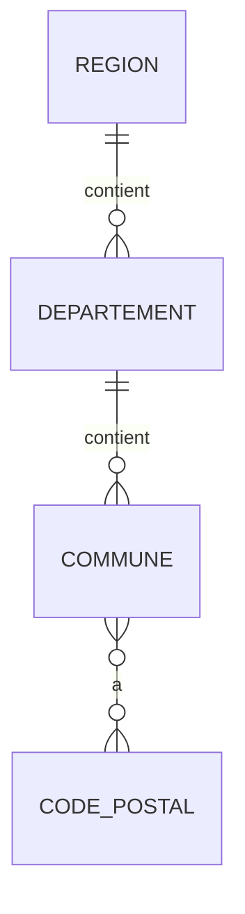

# communes-api

Une API sur les communes françaises, avec Symfony 8.1, API Platform 5 et SQLite.

Les données viennent de l'**API Géo** (gratuite, sans clé) : https://geo.api.gouv.fr

**Duo :** Pape Bathily, (binôme à compléter)

## Installation

```bash
git clone https://github.com/Pape42/communes-api.git
cd communes-api
composer install
symfony console doctrine:migrations:migrate -n
symfony console app:import-communes 92
symfony serve -d
```

Puis ouvrir http://127.0.0.1:8000/api

## Le modèle



- Une commune est dans **un** département, un département a **plusieurs** communes (ManyToOne).
- Un département est dans **une** région, une région a **plusieurs** départements (ManyToOne).
- Une commune peut avoir **plusieurs** codes postaux, un code postal peut avoir **plusieurs** communes (ManyToMany).

Chaque entité a une **clé naturelle** unique : le code INSEE pour la commune, le code pour les autres.

## L'import

```bash
symfony console app:import-communes 92   # 36 communes importées.
symfony console app:import-communes 92   # 0 communes importées. (pas de doublon)
```

| Champ de l'API Géo | Devient |
|---|---|
| `code` | `Commune.codeInsee` (caché dans l'API) |
| `nom` | `Commune.nom` |
| `population` | `Commune.population` |
| `surface` | `Commune.surface` |
| `departement` | l'entité `Departement` |
| `region` | l'entité `Region` |
| `codesPostaux` | l'entité `CodePostal` |

**Règles :**

1. Une commune sans code, nom, département ou région est ignorée.
2. Une commune déjà en base (même code INSEE) est ignorée.
3. La région, le département et les codes postaux sont retrouvés par leur code, sinon créés.
4. Le nom est coupé à 255 caractères.
5. Tout est enregistré en une fois à la fin.

Le mapping complet : [docs/mapping.xlsx](docs/mapping.xlsx)

## Utilisation de l'IA

Claude, pour l'aide au code. Code relu et testé par le duo.
